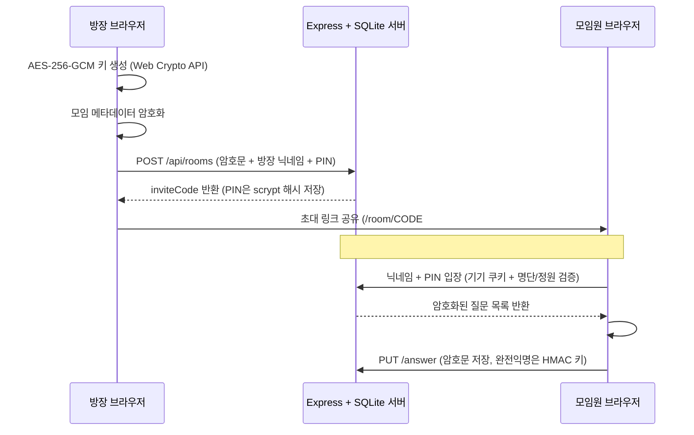
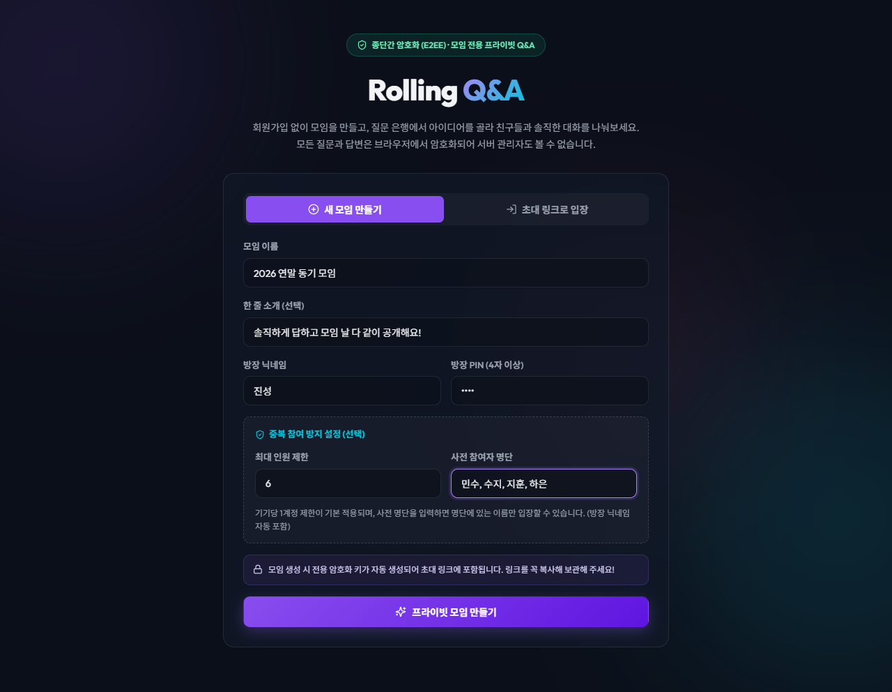
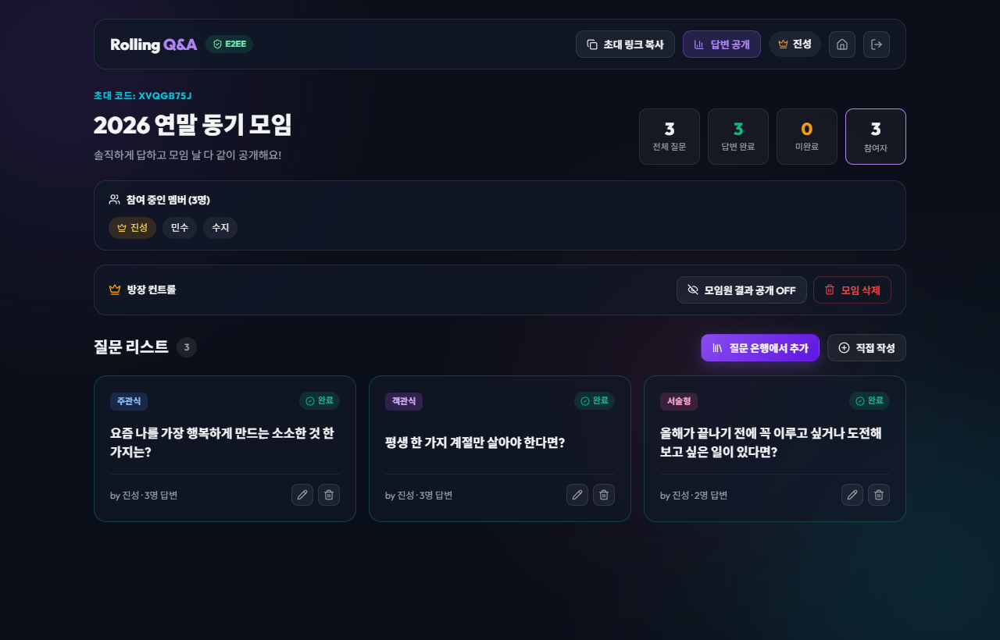
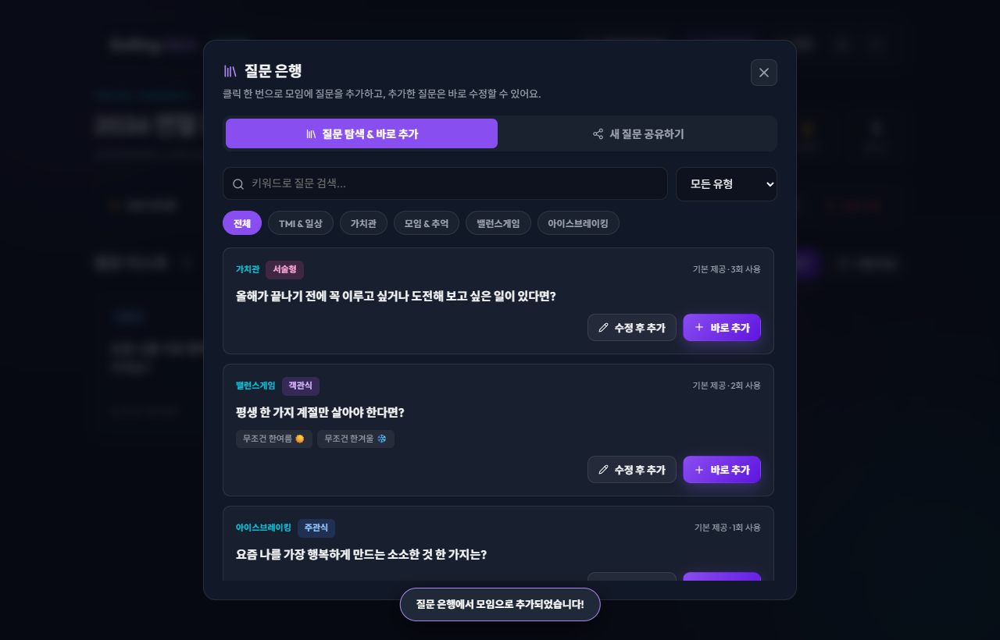
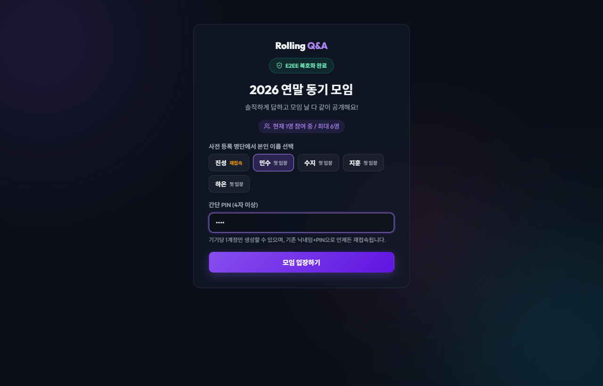
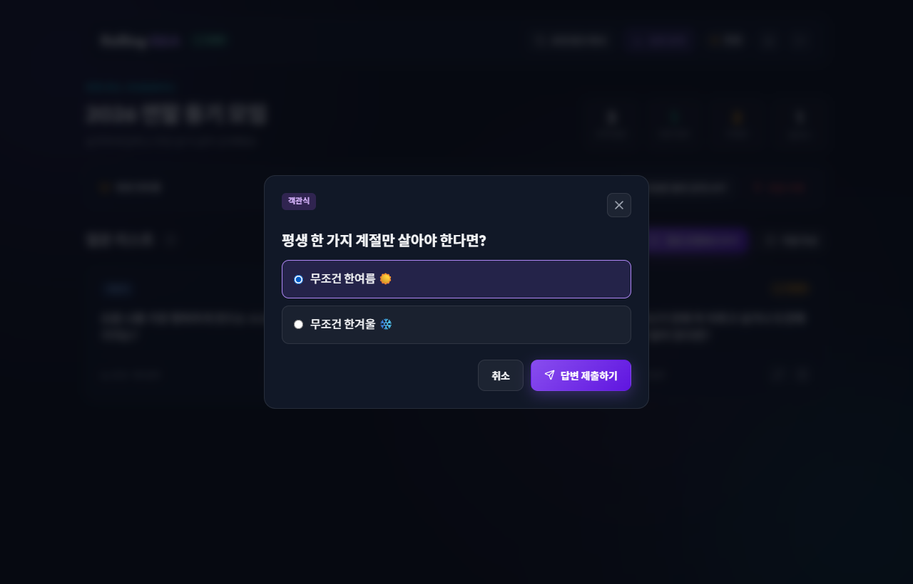
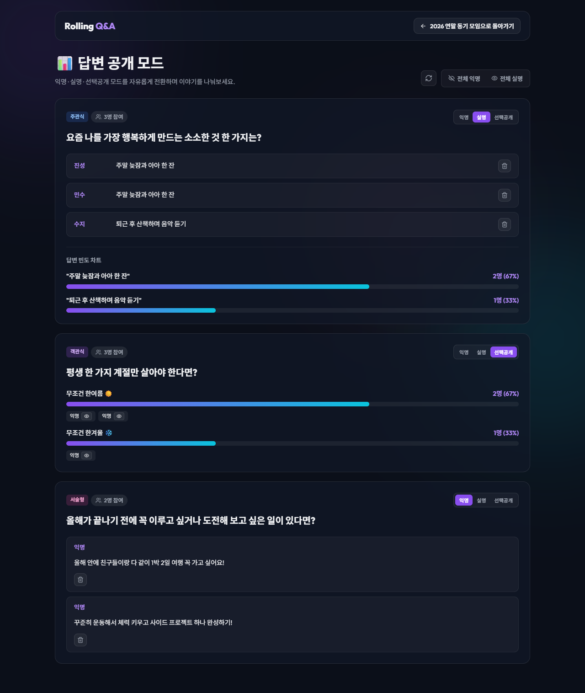

# Rolling Q&A v2

> **모임별 프라이빗 질문 & 답변 보드** — 회원가입 없이 초대 링크로 참여하고, **종단간 암호화(E2EE)**로 프라이버시를 지키며, **공용 질문 은행**에서 클릭 한 번으로 질문을 추가해 함께 이야기를 나누는 웹 애플리케이션입니다.

---

## 프로젝트 개요 및 v1 → v2 업그레이드 배경

기존 v1([lTvTl/Rolling-QnA](https://github.com/lTvTl/Rolling-QnA))은 1회성 소규모 모임을 위해 빠르게 제작된 CSV 기반 프로토타입이었습니다. 여러 모임에서 안전하게 재사용할 수 있도록 **데이터 저장 구조, 보안 아키텍처, 프론트엔드 UI/UX를 전면 재설계**했습니다.

| 영역 | v1 (기존) | v2 (현재) |
| :--- | :--- | :--- |
| **공간 격리** | 모든 사용자가 하나의 전역 게시판 공유 | **모임(Room)별 완전 격리** + 모임별 독립 방장 권한 |
| **저장소 & 동시성** | CSV 파일 (`readFileSync/writeFileSync` 경쟁 상태 위험) | **SQLite (`node:sqlite`, WAL 모드, 외래 키 `CASCADE`)** |
| **프라이버시** | 서버 평문 저장 (서버 관리자 열람 가능) | **브라우저 종단간 암호화 (E2EE, AES-256-GCM)** — 서버 관리자도 열람 불가 |
| **참여 & 중복 방지** | 회원가입 필수, 전역 `admin` 1명 | **회원가입 없음 (닉네임 + PIN)** + 기기당 1계정 쿠키 + 사전 명단/최대 인원 제한 |
| **질문 작성 UX** | 매번 직접 수기 입력 | **공용 질문 은행** (카테고리·검색 탐색 → 원클릭 추가 & 즉시 수정 + 공유) |
| **보안 버그 수정** | 관리자 API 권한 누락, 평문 비밀번호, XSS 위험 | `requireRoomHost` 엄격 검증, `scrypt` PIN 해싱, React 기본 이스케이프, Rate Limiting |
| **프론트엔드** | Vanilla JS 단일 파일(1,645줄, 폼 중복) | **React 19 + Vite 6** 컴포넌트 기반 모듈화 |

---

## 시스템 아키텍처 & 종단간 암호화(E2EE) 흐름

모임을 생성하면 브라우저가 **AES-256-GCM 비밀키**를 자동 생성해 초대 URL의 해시(`#key=...`)에 포함합니다. URL 해시는 HTTP 요청으로 서버에 전송되지 않으므로, **서버 DB에는 암호문만 저장**됩니다.



---

## 주요 기능 미리보기 (실행 화면)

### 1. 프라이빗 모임 개설 & 중복 참여 방지 설정
- 회원가입 없이 모임 이름, 방장 닉네임·PIN만 입력하면 즉시 모임이 생성됩니다.
- **중복 참여 방지**: 기본으로 **브라우저/기기당 1계정 제한(`HttpOnly` 쿠키)**이 적용되며, 선택적으로 **최대 인원 제한** 및 **사전 참여자 명단**을 지정할 수 있습니다.



---

### 2. 모임 대시보드 & 방장 컨트롤
- 상단에서 **초대 링크 복사(암호화 키 포함)**, **참여자 목록 확인**, **답변 완료 현황**을 한눈에 볼 수 있습니다.
- 방장은 **모임원 결과 공개 ON/OFF** 스위치로 모임원 각자 기기에서의 결과 열람을 제어하거나, 모임 종료 후 **모임 삭제**로 모든 데이터를 영구 정리할 수 있습니다.



---

### 3. 공용 질문 은행 (원클릭 추가 + 즉시 수정 + 공유)
- **5개 카테고리(아이스브레이킹, 밸런스게임, TMI & 일상, 가치관, 모임 & 추억)**의 기본 질문 17종을 제공합니다.
- **`+ 바로 추가`** 클릭 시 해당 질문이 모임의 E2EE 키로 즉시 암호화되어 등록되며, 방금 추가한 질문을 바로 수정하거나 **`수정 후 추가`**로 내용을 다듬어 등록할 수 있습니다.
- **`새 질문 공유하기`** 탭을 통해 직접 만든 질문을 공용 질문 은행에 기여할 수 있습니다.



---

### 4. 초대 링크 입장 (사전 명단 선택 & PIN 재접속)
- 방장에게 받은 초대 링크(`#key=...` 포함)로 접속하면 모임 정보가 자동 복호화됩니다.
- 사전 명단이 설정된 모임에서는 명단에서 본인 이름을 선택해 입장하며, 이미 등록된 닉네임은 기존 PIN을 입력해 언제든 이어서 접속할 수 있습니다.



---

### 5. 다양한 질문 유형 답변 (주관식 / 객관식 / 서술형)
- **주관식(단답형)**, **객관식(선택형)**, **서술형** 답변을 지원하며, 모든 답변은 브라우저에서 암호화되어 저장됩니다.
- **완전 익명 질문**은 생성 시 설정이 고정되며, 서버에도 단방향 `HMAC-SHA256` 키만 저장되어 방장을 포함해 누구도 작성자를 역추적할 수 없습니다.



---

### 6. 답변 공개 모드 (Reveal Mode & 실시간 시각화)
- **객관식 비율 차트**, **주관식 답변 빈도 차트**, **서술형 답변 목록**을 시각적으로 제공합니다.
- 전체 또는 질문 카드별로 **익명 / 실명 / 선택공개(눈 아이콘으로 한 명씩 공개)** 모드를 실시간으로 전환할 수 있습니다.



---

## 기술 스택 & 프로젝트 구조

- **Backend**: Node.js (v22+ / v24 내장 `node:sqlite`), Express 5, express-session, Helmet, express-rate-limit
- **Frontend**: React 19, Vite 6, React Router 7, Lucide Icons, Web Crypto API (`AES-256-GCM`)
- **Database**: SQLite (WAL 모드, `FOREIGN KEY` + `ON DELETE CASCADE`)

```text
Rolling-QnA-v2/
├── server/
│   ├── index.js                 # Express 앱, 보안 미들웨어(Helmet, 세션, 기기 쿠키)
│   ├── db/
│   │   ├── database.js          # SQLite 연결(WAL, FK) 및 스키마/마이그레이션
│   │   └── seedQuestionBank.js  # 기본 질문 은행 17종 시드
│   ├── middleware/auth.js       # 모임 멤버 및 방장 권한 검증 미들웨어
│   ├── routes/
│   │   ├── rooms.js             # 모임 생성, 입장(명단/정원/기기 제한), 공개 토글, 삭제
│   │   ├── questions.js         # 모임 질문 CRUD (단일/일괄 암호화 저장)
│   │   ├── answers.js           # 답변 UPSERT, 답변 공개(Reveal), 방장 답변 삭제
│   │   └── questionBank.js      # 공용 질문 은행 조회/검색/공유/사용 횟수
│   ├── utils/crypto.js          # scrypt PIN 해싱, HMAC 완전익명 키, 초대코드 생성
│   └── tests/api.test.js        # 백엔드 API·보안·중복방지·SPA 통합 자동 테스트 (13종)
├── client/
│   └── src/
│       ├── utils/e2ee.js        # 브라우저 Web Crypto API (AES-256-GCM) 암·복호화
│       ├── pages/               # HomePage, RoomPage, RevealPage
│       ├── components/          # QuestionBankModal, QuestionFormModal, AnswerModal, RevealCard
│       └── styles/global.css    # 다크 테마 Glassmorphism 반응형 스타일
└── docs/images/                 # README 기능별 예시 스크린샷
```

---

## 로컬 실행 및 외부 공유 방법

### 1. 설치 및 실행
```bash
# 1) 루트 & 클라이언트 의존성 설치 (Node.js v22+ 권장)
npm install
npm --prefix client install

# 2) 프론트엔드 빌드 후 단일 서버 실행 (http://localhost:3000)
npm run build
npm start

# (선택) 개발 모드 동시 실행 (Frontend :5173 + Backend :3000)
npm run dev
```

### 2. 자동 테스트 실행
```bash
npm run test:api
```
- 모임 격리, 잘못된 PIN 차단, 기기당 1계정 중복 차단, 사전 명단/정원 제한, 일반 멤버의 타인 답변 삭제 차단, 완전익명 닉네임 비노출, 결과 공개 권한, 모임 삭제 시 연쇄 삭제, 프로덕션 SPA 서빙 등 **13개 시나리오**를 자동 검증합니다.

### 3. 도메인 구매 없이 외부 친구들에게 공유하기 (무료 HTTPS)
브라우저 `Web Crypto API`는 `localhost` 또는 **HTTPS** 환경에서만 동작합니다. 도메인을 구매하지 않고도 Cloudflare Quick Tunnel로 즉시 무료 HTTPS 링크를 발급해 공유할 수 있습니다.

```bash
# 로컬 서버(localhost:3000) 실행 상태에서:
cloudflared tunnel --url http://localhost:3000
```
발급된 `https://xxxx.trycloudflare.com` 주소로 접속해 모임을 만들면 초대 링크도 자동으로 해당 HTTPS 주소로 생성됩니다.
